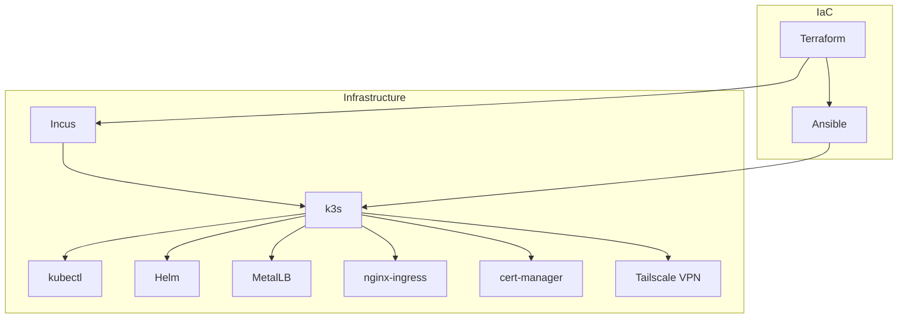
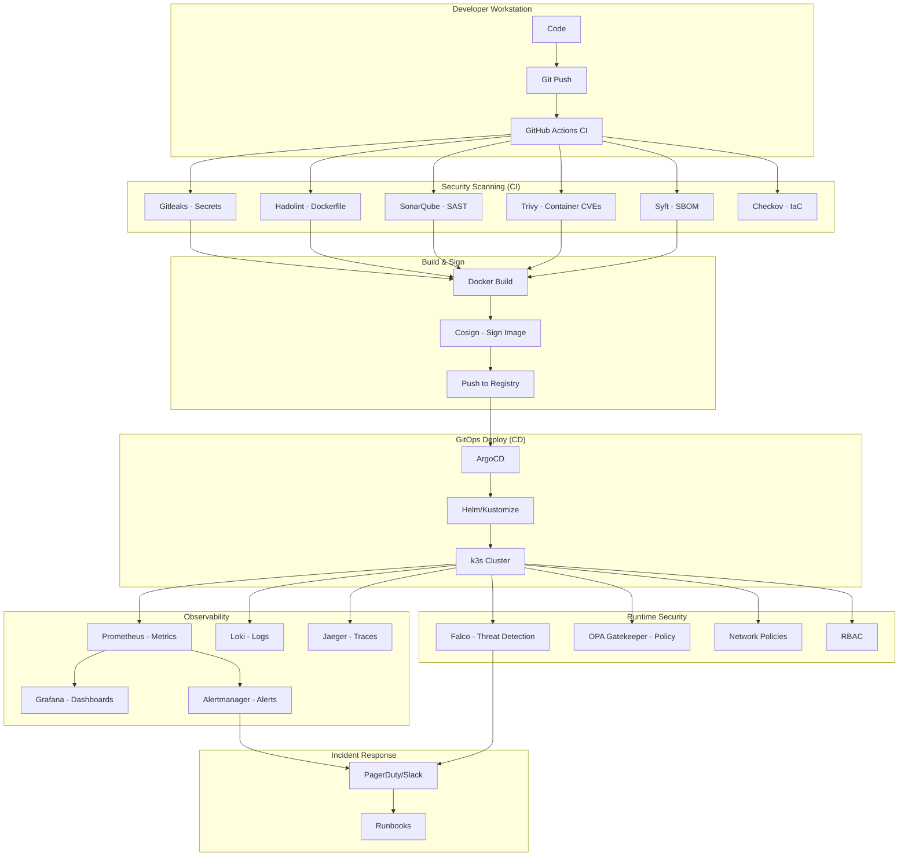

# DevOps & DevSecOps Complete Guide

## From Zero to Production — Every Tool Explained

**70+ tools | 15 categories | 30+ pages per tool | Beginner to Expert**

---

## What Is This Guide?

This is the most comprehensive DevOps and DevSecOps reference ever written for a single project. It covers **every tool** in the modern DevSecOps pipeline — from writing code to deploying to production, from scanning for secrets to responding to incidents.

**Your project:** Contoso Pet Store (8 microservices, polyglot: Python, Go, Node.js, Rust, Vue.js)

**Your infrastructure:** 2 PCs (antix Core Ultra 5 125U + i3 3rd gen), Incus containers, k3s cluster, Tailscale VPN, domain with Let's Encrypt TLS.

---

## Tool Map — 70+ Tools by Category

### Infrastructure Layer



| Category | Tools | Count |
|----------|-------|-------|
| Cluster Setup | k3s, kubectl, helm, incus, tailscale, metallb, nginx-ingress, cert-manager | 8 |
| Code Security | SonarQube, Semgrep, Gitleaks, TruffleHog, Hadolint, ESLint | 6 |
| Dependency Security | Dependabot, Renovate, Snyk, OWASP Dependency Check, OSV-Scanner | 5 |
| Build & CI/CD | GitHub Actions, Act, BuildKit, Helm Charts, Kustomize | 5 |
| Container Security | Trivy, Grype, Syft, Cosign, Notary, Distroless | 6 |
| Infrastructure | Terraform, Ansible, Checkov, tfsec, Trivy IaC | 5 |
| K8s Policy | OPA Gatekeeper, Conftest, Kyverno, Pod Security Standards, Network Policies, RBAC | 6 |
| Secrets | Vault, Vault Agent, Dynamic Secrets, Sealed Secrets, SOPS | 5 |
| GitOps | ArgoCD, Argo Rollouts, Argo Image Updater | 3 |
| Service Mesh | Istio, Kiali | 2 |
| Monitoring | Prometheus, Grafana, Alertmanager, Datadog, Node Exporter, kube-state-metrics | 6 |
| Logging | Elasticsearch, Fluentd, Kibana, Loki | 4 |
| Tracing | Jaeger, OpenTelemetry | 2 |
| Runtime Security | Falco, Tetragon, AppArmor, Seccomp | 4 |
| Chaos & Incident | Litmus Chaos, Chaos Monkey, Runbooks | 3 |
| Compliance | CIS Benchmark, kube-bench | 2 |
| Autoscaling | KEDA, Karpenter, HPA, VPA, Cluster Autoscaler | 5 |
| **TOTAL** | | **75+** |

---

## How to Use This Guide

### By Experience Level

**Beginner (Day 1-7):**
1. Start with `00-prerequisites/README.md`
2. Follow `01-cluster-setup/` — install k3s, kubectl, helm
3. Read `02-code-security/sonarqube.md` — your first security tool
4. Deploy a microservice with `17-microservices-deploy/README.md`

**Intermediate (Week 2-4):**
5. Add security scanning: `02-code-security/gitleaks.md`, `05-container-security/trivy.md`
6. Set up GitOps: `09-gitops/argocd.md`
7. Configure monitoring: `11-monitoring/prometheus.md`, `11-monitoring/grafana.md`

**Expert (Month 2+):**
8. Implement policy engine: `07-kubernetes-policy/opa-gatekeeper.md`
9. Add runtime security: `14-runtime-security/falco.md`
10. Chaos testing: `15-chaos-incident/litmus-chaos.md`
11. Compliance scanning: `16-compliance/kube-bench.md`

### By Task

**"I need to scan my code for vulnerabilities"**
→ `02-code-security/sonarqube.md` + `02-code-security/semgrep.md`

**"I need to scan my Docker images"**
→ `05-container-security/trivy.md` + `05-container-security/syft.md`

**"I need to deploy to Kubernetes"**
→ `09-gitops/argocd.md` + `04-build-ci-cd/helm-charts.md`

**"I need to monitor my cluster"**
→ `11-monitoring/prometheus.md` + `11-monitoring/grafana.md`

**"I need to manage secrets"**
→ `08-secrets-management/vault.md`

**"I need to secure my cluster"**
→ `07-kubernetes-policy/opa-gatekeeper.md` + `14-runtime-security/falco.md`

---

## Architecture Overview



---

## Repository Structure

```
devops-complete-guide/
+-- README.md                          # This file
+-- 00-prerequisites/
|   +-- README.md                      # Hardware, OS, accounts
+-- 01-cluster-setup/
|   +-- k3s.md                         # 30+ pages
|   +-- kubectl.md
|   +-- helm.md
|   +-- incus.md
|   +-- tailscale.md
|   +-- metallb.md
|   +-- nginx-ingress.md
|   +-- cert-manager.md
+-- 02-code-security/
|   +-- sonarqube.md
|   +-- semgrep.md
|   +-- gitleaks.md
|   +-- trufflehog.md
|   +-- hadolint.md
|   +-- eslint.md
+-- 03-dependency-security/
|   +-- dependabot.md
|   +-- renovate.md
|   +-- snyk.md
|   +-- owasp-dependency-check.md
|   +-- osv-scanner.md
+-- 04-build-ci-cd/
|   +-- github-actions.md
|   +-- act.md
|   +-- buildkit.md
|   +-- helm-charts.md
|   +-- kustomize.md
+-- 05-container-security/
|   +-- trivy.md
|   +-- grype.md
|   +-- syft.md
|   +-- cosign.md
|   +-- notary.md
|   +-- distroless.md
+-- 06-infrastructure/
|   +-- terraform.md
|   +-- ansible.md
|   +-- checkov.md
|   +-- tfsec.md
|   +-- trivy-iac.md
+-- 07-kubernetes-policy/
|   +-- opa-gatekeeper.md
|   +-- conftest.md
|   +-- kyverno.md
|   +-- pod-security-standards.md
|   +-- network-policies.md
|   +-- rbac.md
+-- 08-secrets-management/
|   +-- vault.md
|   +-- vault-agent.md
|   +-- vault-dynamic-secrets.md
|   +-- sealed-secrets.md
|   +-- sops.md
+-- 09-gitops/
|   +-- argocd.md
|   +-- argo-rollouts.md
|   +-- argo-image-updater.md
+-- 10-service-mesh/
|   +-- istio.md
|   +-- kiali.md
+-- 11-monitoring/
|   +-- prometheus.md
|   +-- grafana.md
|   +-- alertmanager.md
|   +-- datadog.md
|   +-- node-exporter.md
|   +-- kube-state-metrics.md
+-- 12-logging/
|   +-- elasticsearch.md
|   +-- fluentd.md
|   +-- kibana.md
|   +-- loki.md
+-- 13-tracing/
|   +-- jaeger.md
|   +-- opentelemetry.md
+-- 14-runtime-security/
|   +-- falco.md
|   +-- tetragon.md
|   +-- apparmor.md
|   +-- seccomp.md
+-- 15-chaos-incident/
|   +-- litmus-chaos.md
|   +-- chaos-monkey.md
|   +-- runbooks.md
+-- 16-compliance/
|   +-- cis-benchmark.md
|   +-- kube-bench.md
+-- 17-microservices-deploy/
|   +-- README.md
+-- diagrams/
|   +-- architecture-overview.md
|   +-- pipeline-flow.md
|   +-- security-layers.md
|   +-- data-flow.md
+-- scripts/
|   +-- install-all.sh
|   +-- verify-all.sh
|   +-- quick-start.sh
```

---

## Quick Start

```bash
# Clone this repo
git clone https://github.com/YOUR_USERNAME/devops-complete-guide.git
cd devops-complete-guide

# Or just read the READMEs — no installation needed
```

---

## Contributing

This guide is a living document. If you find errors, want to add tools, or improve explanations, please open an issue or PR.

---

## License

MIT
